<p align="center">
  
</p>

## (OJO) https://aulalogica.onrender.com (el plan gratuito tarda ~1 min en despertar)
## REQUISITO PARA INGRESAR A LA PÁGINA WEB SE DEBE INGRESAR DESDE UN COMPUTADOR O LAPTOP
Aplicativo didáctico de **Fundamentos de Programación en Java** — Proyecto Integrador,
Universidad Técnica de Ambato · FISEI · Ing. José Caiza · julio–diciembre de 2026.

Reto: *¿cómo enseñar a otro estudiante los fundamentos de programación mediante una aplicación web
sencilla, clara e interactiva desarrollada en Java?*

## Integrantes y roles

| Integrante | Rol |
|---|---|
| Kevin Garcés | _(completar)_ |
| Esteban Zambrano | _(completar)_ |
| Cristian Gómez | _(completar)_ |
| Erick Cordonez | _(completar)_ |

## Tecnologías

Java 21 (OpenJDK LTS) · Spring Boot 3.3 · Spring Web · Thymeleaf · Validation · Maven · HTML5/CSS3 ·
Visual Studio Code · GitHub. Three.js (CDN) solo para la animación 3D de la portada.
No usa base de datos: los datos son clases y listas en memoria.

## Requisitos previos

- JDK 21 (`java -version`)
- Maven 3.9+ (`mvn -version`) o, en VS Code, *Extension Pack for Java* + *Spring Boot Extension Pack*
- Navegador moderno

## Cómo ejecutar (Visual Studio Code)

1. Abrir la carpeta `aulalogica` en VS Code.
2. Esperar a que la extensión de Java importe el proyecto Maven.
3. Abrir `AulaLogicaApplication.java` y pulsar **Run** sobre `main`
   (o desde la terminal: `mvn spring-boot:run`).
4. Abrir **http://localhost:8080**.

Compilar y probar: `mvn clean verify` · Generar JAR: `mvn clean package` y luego
`java -jar target/aulalogica-1.0.0.jar`.

## Recorrido de demostración

1. Portada 3D: usar la rueda del mouse para entrar y pulsar **Inicio**.
2. **Registrarme** (o *Entrar como invitado*) → menú **Contenidos** (14 lecciones con ejemplo resuelto y pregunta).
3. **Práctica en Java**: 7 formularios (selección, ciclos, validación…) procesados por Java.
4. **Mecanografía**: 14 niveles con teclado virtual; se desbloquean con 90 % de precisión.
5. **Evaluación**: 5 evaluaciones con nota y retroalimentación por pregunta.
6. **Glosario** (22 conceptos), **Progreso**, **Perfil**, **Configuración** y **Equipo** (roles y créditos).

## Arquitectura (MVC por capas)

```
Navegador → Controlador → Servicio → Modelo/datos → Thymeleaf
```

| Ruta | Responsabilidad |
|---|---|
| `src/main/java/ec/edu/uta/aulalogica/controller` | Rutas web y recepción de formularios |
| `src/main/java/ec/edu/uta/aulalogica/service` | Validación, cálculos, puntajes y reglas didácticas |
| `src/main/java/ec/edu/uta/aulalogica/model` | Tema, Ejercicio, Pregunta, Evaluacion, Resultado, Usuario… |
| `src/main/resources/templates` | Páginas Thymeleaf |
| `src/main/resources/static` | CSS, imágenes y JavaScript de interfaz |
| `docs` | Requisitos, arquitectura, bosquejos, evidencias manuales, pruebas, contribuciones y lista de aceptación |

Detalle en [`docs/arquitectura.md`](docs/arquitectura.md). Análisis y requisitos en [`docs/requisitos.md`](docs/requisitos.md); bosquejos en [`docs/bosquejos.md`](docs/bosquejos.md); evidencias manuales en [`docs/evidencias-manuales.md`](docs/evidencias-manuales.md).

## Pruebas

Casos normales, límites e inválidos documentados en [`docs/pruebas.md`](docs/pruebas.md);
automatizados en `src/test/java/.../PracticaServiceTest.java` y `ContenidoServiceTest.java`.

## Limitaciones y mejoras futuras

- Usuarios y progreso viven en memoria: se pierden al detener el servidor.
- Las contraseñas no se cifran (el inicio de sesión es opcional según la guía).
- Mejora futura: persistencia con H2 y estadísticas por usuario.

## Créditos

Imagen de fondo `static/img/fondo.jpg` y animación 3D con [three.js](https://threejs.org) (licencia MIT).
_(Completar con la fuente/licencia de la imagen.)_
