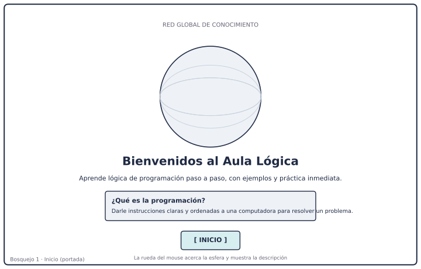
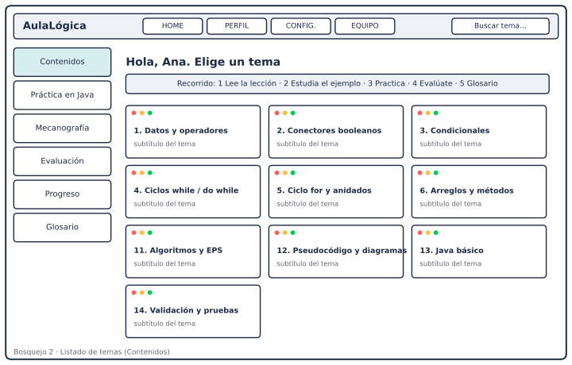
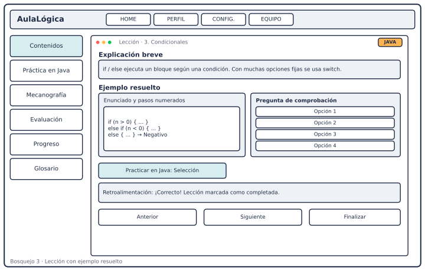
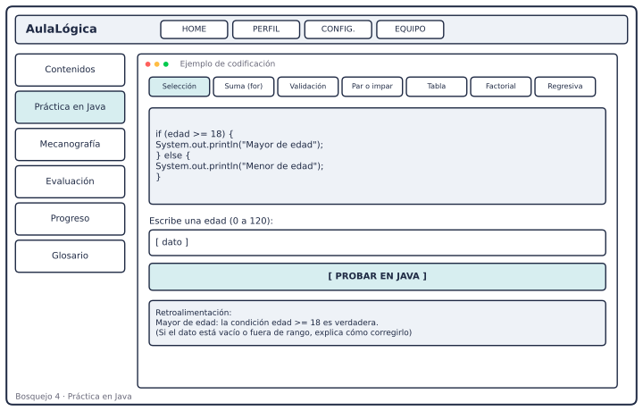
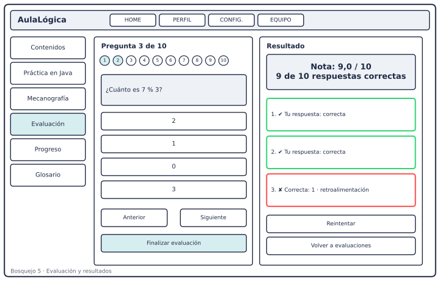
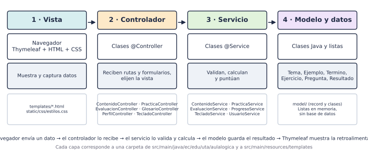

# Bosquejos de baja fidelidad

Cinco pantallas que cubren el recorrido principal. Los archivos SVG están en `docs/bosquejos/`.

| # | Pantalla | Archivo | Qué muestra |
|---|---|---|---|
| 1 | Inicio (portada) | `bosquejos/bosquejo1_inicio.svg` | Esfera 3D, título, descripción y botón **Inicio** |
| 2 | Listado de temas | `bosquejos/bosquejo2_temas.svg` | Menú lateral, buscador, recorrido sugerido y tarjetas de lecciones |
| 3 | Lección | `bosquejos/bosquejo3_leccion.svg` | Explicación, ejemplo resuelto, pregunta, práctica relacionada y retroalimentación |
| 4 | Práctica | `bosquejos/bosquejo4_practica.svg` | Código, campo de dato, botón **Probar en Java** y resultado |
| 5 | Evaluación y resultados | `bosquejos/bosquejo5_evaluacion.svg` | Pregunta con opciones, progreso y nota con corrección |

## Mapa de navegación

Está en [`arquitectura.md`](arquitectura.md). Además del recorrido allí descrito, el menú incluye **Glosario** (`/glosario`).

## Arquitectura

